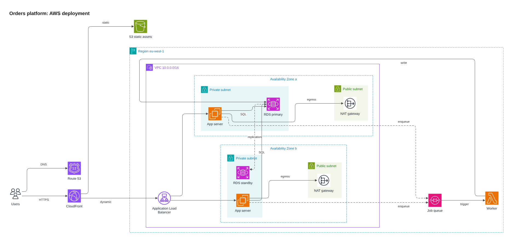
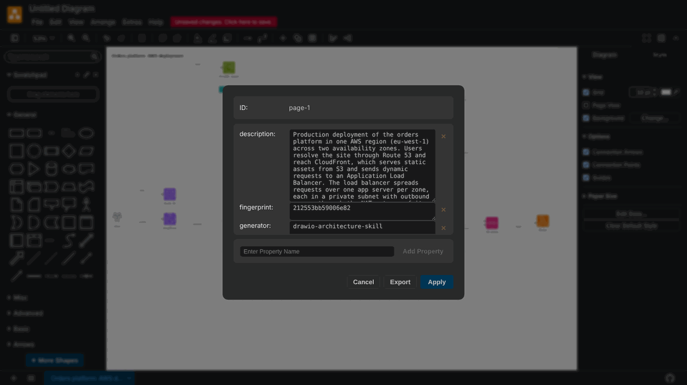
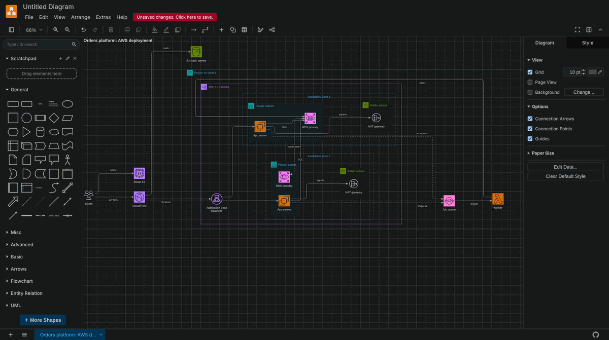
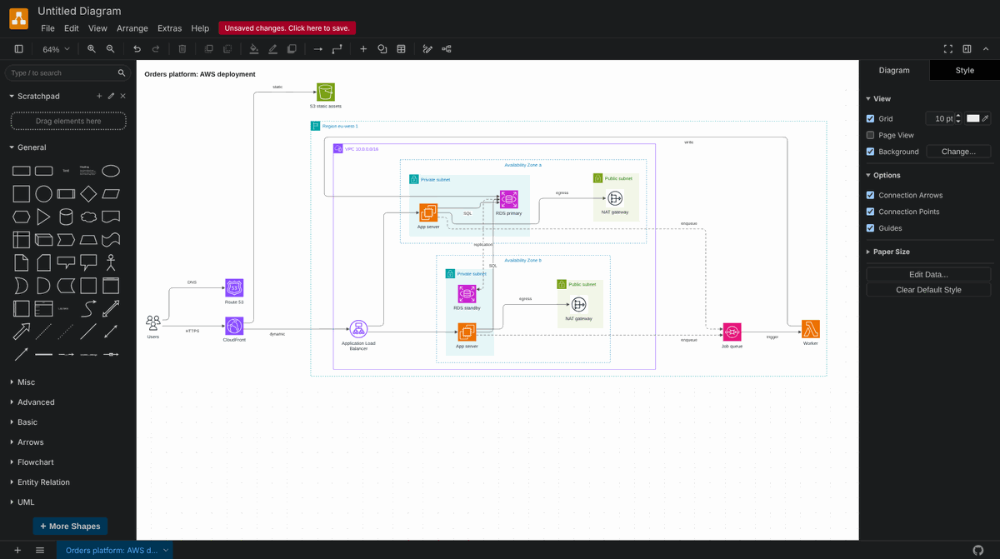
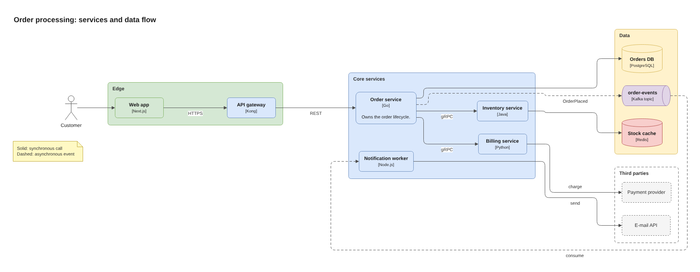

# drawio-architecture

A skill that lets Claude draw cloud, software and infrastructure architecture diagrams as editable draw.io files, check them before handing them over, and keep them up to date: it looks at the diagrams you already have before it draws a new one.



## What it does

Claude first lists the draw.io files that already exist in the project and reads what each one says it shows. If one of them covers the request, that file is updated. Otherwise Claude writes a short JSON description of the system: what exists, what contains what, what connects to what. The skill's scripts then:

1. pick the exact draw.io icons from a catalogue of 2,326 (AWS, Azure, Google Cloud, Kubernetes, Cisco and generic network gear),
2. lay the diagram out automatically, including nested boundaries such as VPC, zone and subnet,
3. write a `.drawio` file that opens and edits normally in draw.io, on a white background that stays white in draw.io's dark theme and in exports (see [Dark theme](#dark-theme)),
4. render it with the official draw.io viewer in a headless browser and report defects measured from the rendered result: invented icon names, overlapping shapes, clipped or colliding labels, edges that run through shapes, and more (over 40 kinds of finding in all),
5. save a PNG, split into tiles when it is too large to judge in one image.

Every diagram it builds also carries a **description** of what it shows, stored inside the file and not drawn (see [Existing diagrams](#existing-diagrams)).

It can also check and edit `.drawio` files that were made elsewhere, give them the same white background, and give them a description.

| You ask for | You get |
|---|---|
| "Diagram our AWS setup: two zones, ALB, ECS, RDS, SQS" | `name.drawio`, `name.png`, and `name.arch.json` (the editable source) |
| "Draw the architecture of this repo / this Terraform" | the same, built from what the files contain |
| "We put a Redis cache in front of the orders database, update the diagram" | the existing diagram found, updated in place, with its description brought up to date |
| "Add a Redis cache to this .drawio and check it" | the edited file, a PNG, and a list of anything the check found |
| "I can't read this diagram in dark mode" | the same file on a locked white background, with its colours pinned |

## Requirements

- Node.js 18 or newer, with npm
- For the one-time setup: network access to `registry.npmjs.org` and `raw.githubusercontent.com`
- For rendering: Chromium through Playwright. Setup uses one already on the machine if it finds it, and can download one if you ask.

Developed and tested on Linux with Node.js 22. macOS and Windows are supported by the code but have not been tested; see [Limitations](#limitations).

## Install

**Claude Code.** Unzip, then copy the `drawio-architecture` folder to one of:

```
~/.claude/skills/drawio-architecture/          # available in every project
<your-project>/.claude/skills/drawio-architecture/    # this project only
```

**Claude app.** Upload `drawio-architecture.zip` under Customize > Skills > Add. The zip already has the layout the app expects (one folder named after the skill, with `SKILL.md` inside).

Then run the one-time setup. Claude does this itself the first time the skill is used, after telling you what it will download; you can also run it yourself:

```
node drawio-architecture/scripts/drawio-arch.mjs setup
```

```
ok      Node.js: v22.22.0
ok      npm packages: elkjs 0.12.0, playwright 1.56.0
ok      draw.io 31.7.0 viewer and stencils: 7 files verified in ~/.cache/drawio-architecture/drawio/24b76c2c...
ok      Chromium for rendering: playwright 1.56.0 (installed by setup), Chromium 141.0.7390.37
ok      end-to-end test: built, rendered and checked a test diagram

Ready.
```

Setup puts about 35 MB into a cache folder (`~/.cache/drawio-architecture` on Linux, `~/Library/Caches/drawio-architecture` on macOS, `%LOCALAPPDATA%\drawio-architecture\Cache` on Windows). It never writes into the skill folder. What it downloads, and how each file is verified, is described in [docs/SECURITY.md](docs/SECURITY.md).

If the Chromium step fails, add `--install-browser` to let Playwright download a browser (about 150 MB).

## Use

Ask Claude for a diagram. For example:

> Draw our order platform on AWS: CloudFront and an ALB in front of two app servers in private subnets across two availability zones, an RDS primary with a standby in the other zone, and an SQS queue feeding a Lambda worker.

The scripts also work on their own, which is useful for trying the skill out or for scripting:

```
cd drawio-architecture

# what diagrams already exist here, and what does each one show?
node scripts/drawio-arch.mjs scan .

# find icon keys
node scripts/drawio-arch.mjs icons load balancer --provider aws

# build, check and render one of the bundled examples (a few seconds)
node scripts/drawio-arch.mjs build examples/aws-web-app.json -o aws.drawio --check --png aws.png

# check a file made elsewhere
node scripts/drawio-arch.mjs check some-diagram.drawio --png some-diagram.png

# give a file made elsewhere a white background, then check it
node scripts/drawio-arch.mjs backdrop some-diagram.drawio -o some-diagram.drawio --check
```

A clean run prints:

```
aws.drawio - page 1 "Orders platform: AWS deployment", 22 shapes, 15 edges, 1847x856 px, 8 edge crossings
  no findings
  image: aws.png (1871x880)
  too large to judge in one image. Look at the overview, then each tile: aws.overview.png + 2 tiles (aws.tile-r1c1.png ...)
Result: clean
```

### Existing diagrams

Each diagram says what it shows. The text is stored in the page itself, as a property of the page, so it travels with the file and is never drawn:

```xml
<object label="" description="Production deployment of the orders platform in one AWS region ..." id="0">
```

In draw.io you can read and change it under Edit > Edit Data with nothing selected:



`scan` lists every diagram under a folder with its description. Claude runs it before anything else and decides from it whether to update a diagram or draw a new one.

```
$ node scripts/drawio-arch.mjs scan docs
2 draw.io files under docs: 2 pages, 1 with a description.

docs/architecture/orders-aws.drawio   (modified 2026-10-06)
  page 1 "Orders platform: AWS deployment": 22 shapes, 15 edges, AWS icons
    description: Production deployment of the orders platform in one AWS region (eu-west-1) across two availability zones. Users resolve ...
    built by this skill and not changed since: update it by changing its spec and rebuilding (spec command)

docs/old/legacy.drawio   (modified 2026-09-12)
  page 1 "Shop": 5 shapes, 3 edges
    no description. Contains: Web app, API, Database, Cache.
    drawn by hand or with another tool: update it by editing the XML
```

How a diagram is updated depends on where it came from, which the last line of each entry states:

| The diagram | How it is updated |
|---|---|
| was built by this skill and nobody has rearranged it since | The spec it was built from is stored in the file. `spec file.drawio -o file.arch.json` writes it out; Claude changes it and builds over the same file. The layout is recomputed. |
| was drawn by hand, made with another tool, or rearranged by hand after it was built | Claude edits the XML in place and leaves your layout alone. `build` refuses to write over such a file unless `--overwrite` is given. |

The skill tells the two apart by a fingerprint of the drawing that it stores at build time. Opening and saving the file in draw.io does not change the fingerprint; moving, adding, deleting or relabelling something does.

A diagram that has no description yet (anything not built by this version of the skill) gets one from `describe file.drawio --set "..." -o file.drawio`. Claude does this for a file it has worked on. `check` reports a page without one as a `no-description` note.

### Dark theme

draw.io's dark theme recolours a diagram when it opens it: dark text becomes light, fills are inverted, and so is a white box that someone has drawn behind the diagram by hand. The picture below is the AWS example, built without a background, in draw.io 31.7.0 with the dark theme on.



Every diagram the skill builds is therefore pinned to white. This is the same example as the skill builds it by default, in the same dark editor:



Three things in the file do this:

| In the file | Effect |
|---|---|
| a white box, `backdrop`, in a layer of its own called `Background`, behind everything | PNG and SVG exports have white behind the whole diagram, even with "transparent background" ticked |
| that layer is locked | the box cannot be selected, dragged or deleted while you edit; a click on it counts as a click on the empty canvas, and new shapes go into the normal layer |
| `adaptiveColors="none"` and a white page colour on the page | draw.io stops recolouring shapes, text and lines, and the canvas around the box is white too |

`check` verifies it by drawing the page under both themes and counting what changes colour; for a pinned diagram the count is zero. `check --theme dark --png file.png` writes the picture a dark-theme user would see.

For a file made elsewhere, `backdrop` adds all three. If the file already has a hand-drawn white box behind the diagram, that box is kept and moved into a locked layer. Run the command again after adding shapes and it grows the box to fit.

To resize the box yourself in draw.io: View > Layers, click the lock next to `Background`, resize the box, lock the layer again.

If you want a transparent diagram that follows the viewer's theme, put `"background": "none"` in the spec.

### Examples

`examples/` holds seven specs that build clean. They are the quickest way to see what a spec looks like.

| File | Shows |
|---|---|
| `aws-web-app.json` | Two availability zones side by side, nested region > VPC > zone > subnet |
| `azure-web-app.json` | Subscription, resource group, virtual network and subnets with Azure icons |
| `gcp-data-pipeline.json` | A left-to-right data pipeline grouped by stage |
| `kubernetes-microservices.json` | Cluster, namespaces and Kubernetes objects |
| `c4-container.json` | A C4 container view, top to bottom |
| `onprem-network.json` | A network topology with Cisco and generic equipment |
| `software-services.json` | Plain boxes for services, data stores and third parties, with a legend |



### Commands

| Command | What it does |
|---|---|
| `setup` | One-time setup. `--install-browser` downloads Chromium. `--prefetch icons` or `--prefetch all` downloads icon files ahead of time for offline use. |
| `doctor` | Reports whether setup is complete. Changes nothing. |
| `scan [folder]` | Lists the draw.io files under a folder (default: the current one) and what each page shows. Read-only. `--json`. |
| `describe <file.drawio>` | Prints each page's description and where the page came from. `--set "text" -o <out.drawio>` stores a description (`--set -` reads it from standard input, `--page N` picks the page). |
| `spec <file.drawio> -o <out.json>` | Writes out the spec a page was built from. Refused when the drawing was changed by hand since (`--force` to get it anyway). |
| `icons <words>` | Searches the icon catalogue. `--provider aws\|azure\|gcp\|k8s\|cisco\|net`, `--limit N`, `--style`, `--json`. |
| `kinds` | Lists box kinds, boundary kinds and colours. |
| `build <spec.json> -o <out.drawio>` | Lays out a spec and writes the file. `--check` and `--png <file>` run the check straight away. Will not replace a diagram that was drawn or changed by hand unless `--overwrite` is given. |
| `check <file.drawio>` | Renders and inspects a file. `--png <file>`, `--scale 1..3`, `--theme light\|dark`, `--json`, `--ignore kind,kind`, `--no-render`, `--offline`. |
| `backdrop <file.drawio> -o <out.drawio>` | Gives every page a locked white background box sized to its content and pins its colours. `-o` may be the same file. `--margin N` (default 20), `--fit` to shrink an oversized box, `--check`, `--png <file>`. |
| `outline <file.drawio>` | Prints a compact description of an existing file. |
| `decompress <file.drawio> -o <out.drawio>` | Rewrites a compressed file as plain XML. |
| `serve <file.drawio>` | Shows the rendered file at a local address until you press Ctrl+C. |

Exit codes: `0` done and clean, `1` findings or a rejected spec, `2` could not run.

### Settings

All optional, set as environment variables.

| Variable | Effect |
|---|---|
| `DRAWIO_ARCH_CACHE` | Cache folder to use instead of the default. |
| `DRAWIO_ARCH_PLAYWRIGHT` | Folder whose `node_modules` contains the Playwright to use. |
| `DRAWIO_ARCH_CHROMIUM` | Path to a Chromium or Chrome executable to use. |
| `DRAWIO_ARCH_NO_SANDBOX=1` | Start Chromium without its sandbox (some containers need this). |
| `HTTPS_PROXY`, `NO_PROXY` | Used for downloads from GitHub. Only `http://` proxies are supported. |

## What is in the folder

```
drawio-architecture/
├── SKILL.md              instructions Claude follows
├── README.md             this file
├── references/           detail Claude reads when needed
│   ├── spec.md           every spec field and kind
│   ├── findings.md       every finding the check can report, with fixes
│   ├── xml-editing.md    rules for editing an existing .drawio file
│   └── patterns.md       how to model common architectures
├── scripts/
│   ├── drawio-arch.mjs   the command-line entry point
│   ├── lib/              build, layout, check, download and setup code
│   └── package.json, package-lock.json    the two pinned npm packages
├── assets/
│   ├── icons.json        icon catalogue: key -> draw.io style
│   ├── kinds.json        box and boundary styles
│   ├── drawio-manifest.json   SHA-256 of every draw.io file the skill may download
│   └── viewer/           the page that renders a diagram for checking
├── examples/             seven complete specs
├── tests/                test suite, a diagram full of deliberate defects, and one with a hand-drawn background
├── evals/                test prompts for trying the skill with Claude
├── maintenance/          scripts that regenerate the catalogue and the manifest
└── docs/                 how it works, security, troubleshooting, maintenance
```

## More documentation

- [docs/HOW-IT-WORKS.md](docs/HOW-IT-WORKS.md): the pipeline and the design decisions behind it
- [docs/SECURITY.md](docs/SECURITY.md): what is downloaded and run, what is blocked, licences
- [docs/TROUBLESHOOTING.md](docs/TROUBLESHOOTING.md): setup and rendering problems
- [docs/MAINTENANCE.md](docs/MAINTENANCE.md): running the tests, moving to a newer draw.io release, adding kinds
- [references/spec.md](references/spec.md): the spec format, if you want to write one by hand

## Limitations

- **Scope.** Architecture diagrams only. Flowcharts, sequence diagrams, ER and UML class diagrams are better served by other tools; the skill's description tells Claude not to use it for them.
- **Layout.** Layered layout suits flows and hierarchies. Dense meshes with many crossing dependencies will still look busy; the fix is usually to split the diagram.
- **Icons.** The catalogue is what ships with draw.io 31.7.0. The Google Cloud set is draw.io's hexagon set, which does not include every current product. There are no logos for third-party software such as PostgreSQL or Kafka; those are drawn as labelled boxes.
- **Fonts.** Label measurements depend on the fonts installed where the check runs. On a machine with no Helvetica- or Arial-compatible font, text renders wider and the check may report overflow that draw.io on your desktop would not show.
- **Platforms.** Not tested on macOS or Windows, or on Node.js versions other than 22. Two code paths were not exercised during development: `setup --install-browser` (the build machine already had Chromium) and starting Chromium with its sandbox on (the build machine runs as root, where the sandbox is unavailable).
- **Edited layouts.** A file built by this skill gives every edge fixed waypoints. If you drag shapes around in draw.io afterwards, their edges keep the old route: clear the waypoints of those edges in draw.io, or change the spec and rebuild.
- **The background box does not follow your edits.** If you place shapes beyond it in draw.io, they are still on a white canvas while you edit, but an export with a transparent background has nothing behind them. Run `backdrop` on the file, or resize the box as described under [Dark theme](#dark-theme).
- **Diagrams from the previous version of this skill** have no description and no spec inside, so they are listed as hand-made. Rebuilding one from its `.arch.json` (with a `description` added, and `--overwrite`) brings it up to date.
- **What the fingerprint does not notice.** Sending a shape to the front or back, and changes to page settings, do not count as edits. Everything else does.
- **Diagrams saved inside a picture** (`.drawio.svg`, `.drawio.png`) are listed by `scan` but not read.
- **The description is plain text in the file.** Anyone who can open the file can read it, so it must not contain secrets. The same goes for the stored spec, which holds nothing that is not already on the diagram.
- **Dark theme, tested where.** The white background was verified in the draw.io 31.7.0 editor with its dark theme on (canvas, selection behaviour, PNG and SVG export) and in the viewer that the check uses. It was not tested in the desktop app, the VS Code extension, older draw.io releases, or with PDF export. Releases from before draw.io recoloured diagrams ignore the `adaptiveColors` setting; there the white box does the work on its own.
